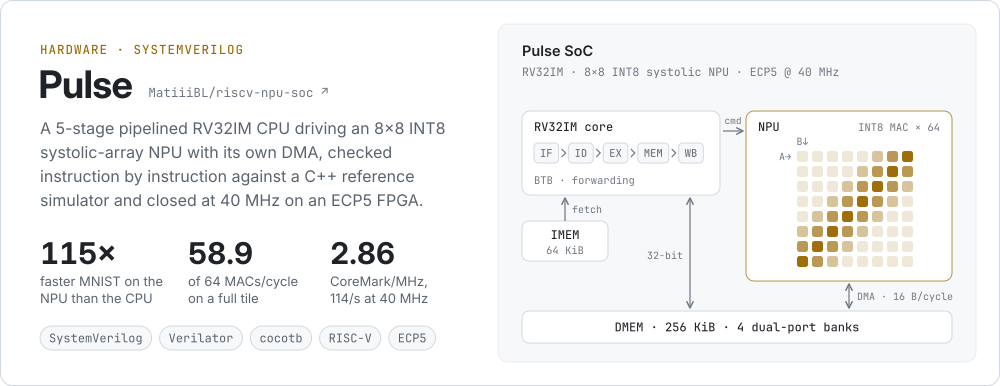
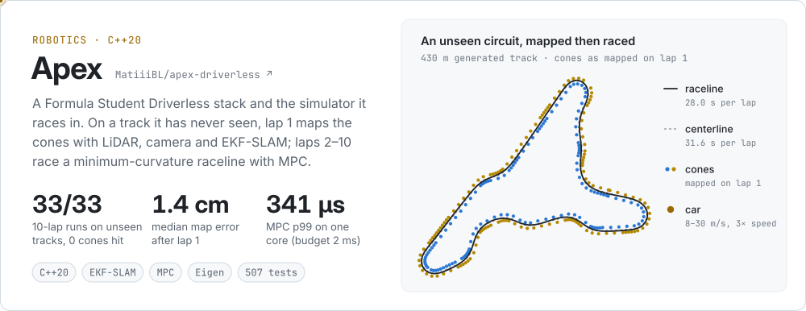
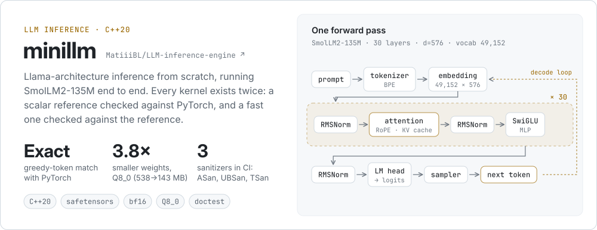
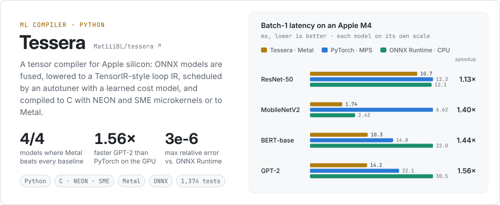
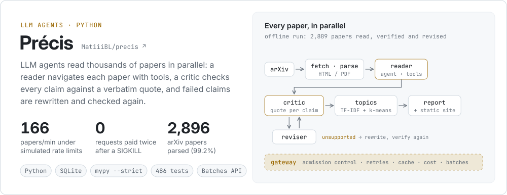
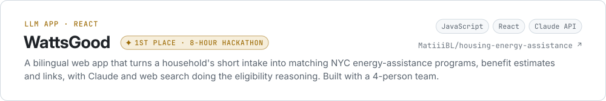

<picture>
  <source media="(prefers-color-scheme: dark)" srcset="assets/banner-dark.svg">
  
</picture>

I'm a Computer Engineering student at Columbia (AI minor, class of 2029), originally from Montevideo. I like problems where the system has to be fast *and* right, from RTL and robotics to ML compilers and LLM pipelines. I profile before I optimize, check every fast path against a slow reference, and benchmark against the libraries people already use.

Right now I'm an AI engineer at **Forva Systems**, building the AI backend of an EMS platform for ambulance crews, and I'm on **Columbia Formula Racing**.

[LinkedIn](https://www.linkedin.com/in/matias-blanco-uy/) · [matias.blancobalaguer@columbia.edu](mailto:matias.blancobalaguer@columbia.edu)

### Selected work

<a href="https://github.com/MatiiiBL/riscv-npu-soc">
  <picture>
    <source media="(prefers-color-scheme: dark)" srcset="assets/pulse-dark.svg">
    
  </picture>
</a>

<a href="https://github.com/MatiiiBL/apex-driverless">
  <picture>
    <source media="(prefers-color-scheme: dark)" srcset="assets/apex-dark.svg">
    
  </picture>
</a>

<a href="https://github.com/MatiiiBL/HNSW_vector_search">
  <picture>
    <source media="(prefers-color-scheme: dark)" srcset="assets/vecdex-dark.svg">
    
  </picture>
</a>

<a href="https://github.com/MatiiiBL/LLM-inference-engine">
  <picture>
    <source media="(prefers-color-scheme: dark)" srcset="assets/minillm-dark.svg">
    
  </picture>
</a>

<a href="https://github.com/MatiiiBL/tessera">
  <picture>
    <source media="(prefers-color-scheme: dark)" srcset="assets/tessera-dark.svg">
    
  </picture>
</a>

<a href="https://github.com/MatiiiBL/precis">
  <picture>
    <source media="(prefers-color-scheme: dark)" srcset="assets/precis-dark.svg">
    
  </picture>
</a>

<a href="https://github.com/MateoVidalS/makecu-guante">
  <picture>
    <source media="(prefers-color-scheme: dark)" srcset="assets/memo-dark.svg">
    
  </picture>
</a>

<a href="https://github.com/MatiiiBL/housing-energy-assistance">
  <picture>
    <source media="(prefers-color-scheme: dark)" srcset="assets/wattsgood-dark.svg">
    
  </picture>
</a>

<a href="https://github.com/MatiiiBL/ShellC">
  <picture>
    <source media="(prefers-color-scheme: dark)" srcset="assets/shellc-dark.svg">
    
  </picture>
</a>

### Experience

**Forva Systems** · AI Engineer · New York · Dec 2025 – present 
AI backend of an EMS platform for EMTs and paramedics. I designed the anti-hallucination guardrails for clinical LLM extraction (schema-constrained outputs, verbatim-quote provenance, gap-aware context windows, human sign-off on every medication) and a dev/held-out eval harness that scores word error rate, medical-term survival and number grounding.

**Y Combinator Startup School** · Selected participant · San Francisco · Jul 2026 
Picked from 30,000+ applicants. In the 48-hour build sprint I wrote an agentic Python pipeline that runs parallel LLM summarization over 2,000+ research PDFs.

**AdAstra** · Software Engineer Intern · Montevideo · Sep – Dec 2024 
Full-stack social platform in C#, React, PostgreSQL and Python. Deployed Gemma 3 on-premise to flag AI-generated images and stop fraud.

### Toolbox

**Hardware** &nbsp; `SystemVerilog` `RISC-V` `Verilator` `cocotb` `Yosys / nextpnr` `ECP5 FPGA` 
**Robotics** &nbsp; `EKF-SLAM` `MPC` `QP solvers` `motion planning` `Eigen` 
**Systems** &nbsp; `C++20` `C` `CMake` `NEON / SME SIMD` `POSIX` `Linux` 
**Correctness** &nbsp; `ASan` `UBSan` `TSan` `libFuzzer` `Valgrind` `GitHub Actions` 
**ML** &nbsp; `PyTorch` `ONNX` `Metal` `NumPy` `pybind11` `MediaPipe` `LLM agents & evals` 
**Product** &nbsp; `TypeScript` `React` `Node.js` `C# / ASP.NET Core` `PostgreSQL` `Flutter`

Spanish (native) · English (fluent) · Portuguese (advanced) · Chinese (learning)

The graphics on this page are drawn by <a href="scripts/render.py">scripts/render.py</a>; the vecdex and Tessera charts plot each project's benchmark results, and the Apex track is one of its evaluation circuits.
